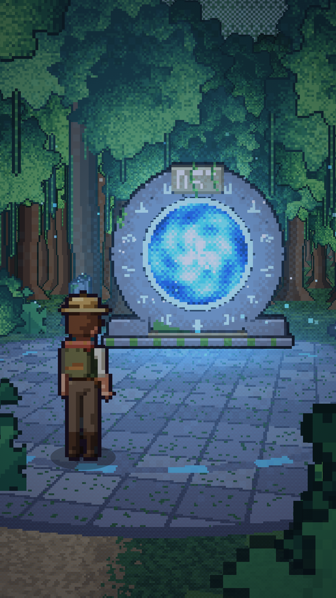

# Part 1 → Part 2 hand-off: the final narrative frame

Part 1 ("The Discovery") ends on one fixed composition. Part 2 ("The Connection")
should open on exactly this frame and continue from it.

Clean renders of the frame (no text, no UI):

* `docs/final_frame_1080x1920.png`: vertical 9:16, the primary format
* `docs/final_frame_1920x1080.png`: the same camera on a 16:9 screen (the world extends sideways)
* Live render: `index.html?frame=final`
* Machine-readable values: `docs/final_frame.json`

## The frame in words
An over-the-shoulder shot from behind the explorer's **right** shoulder. The explorer
stands still in the bottom-left third on the ancient stone plaza and faces east, toward
the portal. The DSI portal sits center-right: a stone ring with the DSI keystone and
fully awake swirling blue energy. Pixel motes rise around it, and blue light pools on
the plaza tiles. Dark jungle surrounds the clearing. The camera does not move.

## Exact values (world units: 1 unit = 1 sprite pixel; +X east, +Z north, Y up)

| Element | Value |
|---|---|
| Film time when the frame locks | `t = 20.0 s`. Text appears over it after `19.75 s`; the frame itself stays static until the end at 26 s |
| Camera position | `x = -1190, z = -60`, height `h = 60` |
| Camera yaw | `76°` (0° = north, 90° = east), so it looks east-north-east |
| Horizon line | `0.40 × screen height` (y-shear pitch, Mode 7) |
| Focal length | `F = 300` virtual px (virtual safe frame 180×320) |
| Explorer | `x = -1046, z = 0`, heading `90°` (east), anim `idle` frame `0`, sprite-sheet column `9` (3/4 back view), `portal` lighting variant blended at 100% |
| Portal | `x = -880, z = 0`, faces west (-X), scale `1.5`, intensity `1.0` (±6 % slow pulse), energy anim at 10 fps |
| Distance explorer → portal | 166 units (about 3.6 explorer heights) |
| Plaza | circle at `x = -960, z = 0`, radius `125`; rune ring at r = 92 lights up with the portal |
| Grade | multiply `#b9c4dc`, vignette `0.62`, fog distance `2400` |
| Sun | azimuth -0.92 rad (north-west), elevation 0.36 rad. It is behind the camera and blocked by the canopy |

All of these come from code, not from copied numbers:
`finalCam(1)` and `FINAL` in `js/director.js`, and `WORLD.portal` / `WORLD.plaza` in `js/world.js`.

## How Part 2 should start
1. Reuse this repository's engine and assets. The island, the explorer sprite sheet
   (`assets/sprites/explorer_sheet.png`), the portal art and the world seed
   (`buildObjects()`, mulberry32 seed 1234) are all deterministic, so Part 2 renders
   pixel-identical scenery.
2. Open Part 2 on `finalCam(1)` with `portalAt(t) = 1`, the explorer idle at
   `(-1046, 0)` facing east, and the `MYSTERY_GRADE`. Hold this for about 0.5 s with no
   text, so returning viewers recognise the cliffhanger.
3. Keep the motion direction: the explorer has walked west→east (screen left→right)
   all through Part 1. The natural continuation is a slow push-in past the right
   shoulder toward the portal (camera along +X), then a step into the light.
4. Part 1 deliberately shows **nothing** inside the portal, only animated blue energy
   (`portal_energy_0..11`). The connected islands and the Data Sharing &
   Interoperability reveal belong to Part 2.
